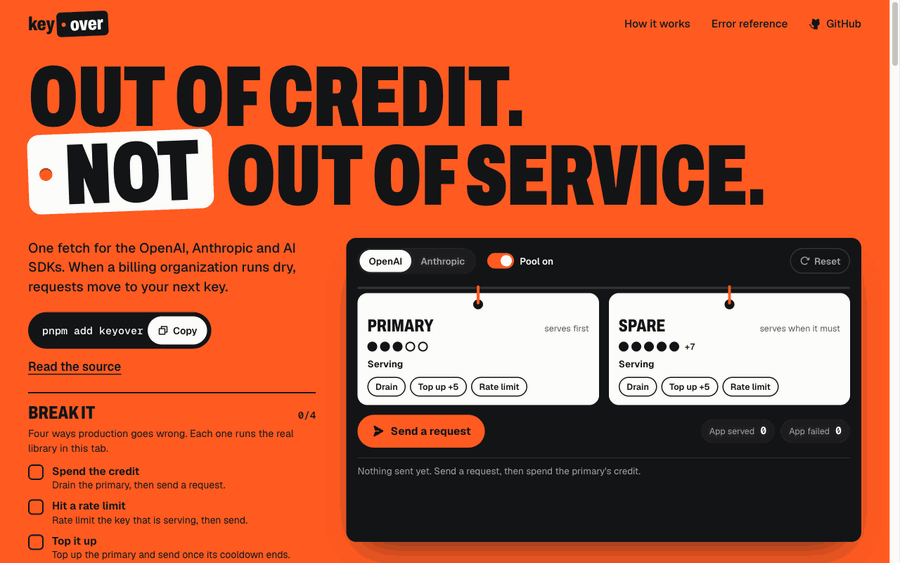

<p align="center">
  
</p>

<p align="center">
  <strong>Out of credit. Not out of service.</strong><br>
  API key failover for OpenAI, Anthropic and the AI SDK.<br>
  When one billing organization runs out of credit, the request moves to your next key.
</p>

<p align="center">
  <a href="https://yempik-ai.github.io/keyover/">Website and playground</a> ·
  <a href="#quick-start">Quick start</a> ·
  <a href="#what-moves-a-request-and-what-does-not">The rule</a> ·
  <a href="https://yempik-ai.github.io/keyover/errors/">Error reference</a> ·
  <a href="#faq">FAQ</a>
</p>

<p align="center">
  <a href="LICENSE"></a>
  <a href="https://github.com/yempik-ai/keyover/actions/workflows/ci.yml"></a>
  
  
</p>

<p align="center">
  
</p>

## What is keyover?

**keyover is an open-source TypeScript library that keeps an AI feature running when the organization that pays for it runs out of credit.** It holds several API keys for one provider, in priority order, behind one `fetch`. When the provider refuses a request because the key's billing organization is out of credit, over a spend limit it set, or the key is no longer accepted, the same request is sent again on the next key, inside the same call. Your code gets a normal response. An event tells you which organization needs a top-up.

It is one option on the SDK client you already have. There is no gateway to run, no new client to learn and no dependency to install with it.

**Try it before you install it.** [The website](https://yempik-ai.github.io/keyover/) runs the real library in your browser against a simulated provider: drain an organization's credit and watch the request move.

## Why

Credit runs out at the worst hour, and the fix waits for someone to wake up, find a card and click.

- A Show HN launch [went dark overnight](https://news.ycombinator.com/item?id=49238851): "I woke up and noticed my OpenAI account failed to fund. So we ran out of funds and it caused things to break for some of you."
- [Auto-recharge silently failed](https://community.openai.com/t/auto-recharge-silently-failed/1385922) for several developers: "it took my site offline for more than an hour." OpenAI support confirmed it and deployed a fix.
- Anthropic says an empty balance with a 400, not a 402. Code that reads every 400 as a bad request [leaves a funded spare unused](https://github.com/router-for-me/CLIProxyAPI/issues/7120).

Most teams already have a second organization: a personal account, a partner program, a startup-credits account. keyover is the few lines that make it take over by itself.

| | A key rotator | A gateway | **keyover** |
|---|---|---|---|
| What you change | Wrap every call, or adopt its client | Route all traffic through a proxy or a hosted service | **One option on your existing client** |
| When it switches keys | On most errors, rate limits included | On the status codes or failures you configure | **Only on a billing or key rejection** |
| A rate limit | Jumps to another key, which is limit evasion | Often falls back | **Stays with your SDK's retry** |
| A timeout or a 5xx | Resent on another key, and it may run twice | Depends on your configuration | **Never resent by the pool** |
| A cap your provider assigned | Routed around | Routed around when the status matches | **Left alone unless you opt in** |
| Where it runs | In your process | A server or a service in the request path | **In your process, with no dependencies** |

If you need routing across providers, budgets per team, a dashboard or key health shared across a fleet, run a gateway such as LiteLLM, Portkey or Bifrost. They do far more than this does. See [Prior art](#prior-art).

## Quick start

```sh
pnpm add https://github.com/yempik-ai/keyover/releases/latest/download/keyover.tgz
```

keyover is not on the npm registry yet, so it installs from the latest release. npm 12 and newer refuse a URL install unless you allow it: `npm install --allow-remote=all https://github.com/yempik-ai/keyover/releases/latest/download/keyover.tgz`.

### OpenAI SDK

```ts
import OpenAI from "openai"
import { createKeyPool, OPENAI } from "keyover"

const pool = createKeyPool({
  provider: OPENAI,
  keys: {
    primary: process.env.OPENAI_API_KEY,
    spare: process.env.OPENAI_API_KEY_SPARE,
  },
})

const openai = new OpenAI(pool.clientOptions)
```

### Anthropic SDK

```ts
import Anthropic from "@anthropic-ai/sdk"
import { ANTHROPIC, createKeyPool } from "keyover"

const pool = createKeyPool({
  provider: ANTHROPIC,
  keys: {
    primary: process.env.ANTHROPIC_API_KEY,
    spare: process.env.ANTHROPIC_API_KEY_SPARE,
  },
})

const anthropic = new Anthropic(pool.clientOptions)
```

### AI SDK

```ts
import { createAnthropic } from "@ai-sdk/anthropic"
import { ANTHROPIC, createKeyPool } from "keyover"

const pool = createKeyPool({ provider: ANTHROPIC, keys: { primary, spare } })

const anthropic = createAnthropic(pool.clientOptions)
```

That is the whole integration. Three things to know:

- **Keys are tried in the order you write them.** The first serves whenever it can. The names (`primary`, `spare`) are yours: they appear in events and status, and the key itself never does.
- **A key that is not set is left out.** A staging environment with one key works unchanged. A pool with no key at all throws at startup.
- **Create one pool per provider per process** and reuse it. The pool is where key health lives.

`pool.clientOptions` is `{ apiKey, fetch }`: the pool's `fetch` and a placeholder key that the pool replaces on every request. Spread it next to your own options: `new OpenAI({ ...pool.clientOptions, timeout: 30_000 })`. Keep keys and the pool on your server.

### Let your agent install it

The repository has a guide written for coding agents: [SPEC.md](SPEC.md). Paste this into yours:

```text
Add keyover to this project. Follow https://github.com/yempik-ai/keyover/blob/main/SPEC.md from start to finish.
```

## What moves a request, and what does not

**A request moves to the next key only on a response the provider defines as a refusal given before any work ran.** A billing or key rejection is such a response, so sending the request again cannot run it twice. Every other answer returns to your SDK untouched, and the SDK's own retry policy applies as before.

| Moves to the next key | Stays with your SDK |
|---|---|
| Out of credit (`credit`) | A rate limit: a traffic control, and your SDK's to retry |
| A spend limit you set (`spend_limit`) | A 5xx or a timeout: it may have run, and a resend could run it twice |
| Key revoked or not accepted (`auth`) | A bad request: another key cannot fix the input |
| | A safety hold, a region restriction, a model the key cannot access |
| | A cap your provider assigned (`provider_limit`), unless you opt in |

keyover adds no retry for an ambiguous failure. It cannot promise more than that: a proxy between you and the provider, or your SDK's own retry of a timeout, is outside what a `fetch` can see.

### A cap your provider assigned

OpenAI and Anthropic both put a monthly ceiling on each usage tier (`organization_usage_limit_exceeded`, `enforced_spend_limit_reached`). That ceiling is the provider's rule, not your budget, so by default the pool returns it to you like a rate limit. If your agreement with the provider allows you to serve from another organization when one reaches its tier, say so:

```ts
createKeyPool({
  provider: OPENAI,
  keys: { primary, spare },
  failoverOn: ["credit", "spend_limit", "auth", "provider_limit"],
})
```

### Providers

Each profile is backed by the provider's own error reference or a field report, and by a test. The full ledger, with the status and body of every answer, is in [`spec/contracts.ts`](spec/contracts.ts) and on the [error reference](https://yempik-ai.github.io/keyover/errors/).

<!-- contracts:start -->
<details open>
<summary><strong>OpenAI</strong> · <code>OPENAI</code></summary>

| Status | Answer | Pool | Evidence |
|---|---|---|---|
| 429 | Prepaid credit balance is depleted<br>`code: credit_balance_exhausted` | `credit` | [documented](https://developers.openai.com/api/docs/guides/error-codes) |
| 429 | You exceeded your current quota, please check your plan and billing details<br>`code: insufficient_quota` | `credit` | [reported](https://stackoverflow.com/questions/75898276/openai-api-error-429-you-exceeded-your-current-quota-please-check-your-plan-a) |
| 429 | Organization reached the monthly spend limit it set<br>`code: organization_spend_limit_exceeded` | `spend_limit` | [documented](https://developers.openai.com/api/docs/guides/error-codes) |
| 429 | Project reached the monthly spend limit it set<br>`code: project_spend_limit_exceeded` | `spend_limit` | [documented](https://developers.openai.com/api/docs/guides/error-codes) |
| 400 | Billing hard limit has been reached<br>`code: billing_hard_limit_reached` | `spend_limit` | [reported](https://community.openai.com/t/billing-hard-limit-reached-api-error/572481) |
| 429 | Organization reached the monthly usage limit OpenAI assigned<br>`code: organization_usage_limit_exceeded` | `provider_limit` | [documented](https://developers.openai.com/api/docs/guides/error-codes) |
| 401 | Incorrect API key provided | `auth` | [documented](https://developers.openai.com/api/docs/guides/error-codes) |
| 429 | Rate limit reached for requests | stays | [documented](https://developers.openai.com/api/docs/guides/error-codes) |
| 429 | Request rate increased too quickly<br>`code: slow_down` | stays | [documented](https://developers.openai.com/api/docs/guides/error-codes) |
| 403 | Country, region, or territory not supported | stays | [documented](https://developers.openai.com/api/docs/guides/error-codes) |

</details>

<details open>
<summary><strong>Anthropic</strong> · <code>ANTHROPIC</code></summary>

| Status | Answer | Pool | Evidence |
|---|---|---|---|
| 400 | Your credit balance is too low to access the Anthropic API | `credit` | [reported](https://github.com/anthropics/claude-code/issues/36604) |
| 402 | An issue with your billing or payment information<br>`type: billing_error` | `credit` | [documented](https://platform.claude.com/docs/en/api/errors) |
| 400 | You have reached your specified API usage limits | `spend_limit` | [documented](https://platform.claude.com/docs/en/api/rate-limits) |
| 400 | You have reached your specified workspace API usage limits | `spend_limit` | [documented](https://platform.claude.com/docs/en/api/rate-limits) |
| 429 | Organization crossed its usage tier's monthly spend cap<br>`details.error_code: enforced_spend_limit_reached` | `provider_limit` | [documented](https://platform.claude.com/docs/en/api/rate-limits) |
| 401 | API key is malformed, revoked or expired<br>`type: authentication_error` | `auth` | [documented](https://platform.claude.com/docs/en/api/errors) |
| 401 | CORS requests are not allowed for this Organization<br>`type: authentication_error` | stays | [documented](https://platform.claude.com/docs/en/api/errors) |
| 400 | Organization is on hold<br>`details.error_code: organization_on_hold` | stays | [documented](https://platform.claude.com/docs/zh-TW/api/ruby/%24shared) |
| 429 | Rate limit<br>`type: rate_limit_error` | stays | [documented](https://platform.claude.com/docs/en/api/rate-limits) |
| 429 | Usage increased too quickly<br>`details.error_code: ramp_limit_exceeded` | stays | [documented](https://platform.claude.com/docs/en/api/rate-limits) |
| 529 | The API is temporarily overloaded<br>`type: overloaded_error` | stays | [documented](https://platform.claude.com/docs/en/api/errors) |

</details>

<details>
<summary><strong>Gemini API</strong> · <code>GEMINI</code></summary>

| Status | Answer | Pool | Evidence |
|---|---|---|---|
| 402 | Your prepayment credits are depleted<br>`status: RESOURCE_EXHAUSTED` | `credit` | [documented](https://discuss.ai.google.dev/t/api-update-depleted-prepay-credits-now-return-http-402-instead-of-429/183654) |
| 402 | Prepay credit balance is depleted (Interactions API)<br>`code: payment_required` | `credit` | [documented](https://aistudio.google.com/docs/api-errors) |
| 400 | API key not valid. Please pass a valid API key<br>`reason: API_KEY_INVALID` | `auth` | [reported](https://discuss.ai.google.dev/t/invalidargument-400-api-key-not-valid-stuck-with-this-error/40782) |
| 401 | API key is missing, invalid or expired (Interactions API)<br>`code: authentication` | `auth` | [documented](https://aistudio.google.com/docs/api-errors) |
| 429 | You have exceeded your daily quota<br>`code: quota_exceeded` | stays | [documented](https://aistudio.google.com/docs/api-errors) |
| 400 | Billing is not enabled for the project<br>`code: failed_precondition` | stays | [documented](https://aistudio.google.com/docs/api-errors) |
| 403 | Key lacks permission, or the project is restricted<br>`code: permission_denied` | stays | [documented](https://aistudio.google.com/docs/api-errors) |

</details>

<details>
<summary><strong>OpenRouter</strong> · <code>OPENROUTER</code></summary>

| Status | Answer | Pool | Evidence |
|---|---|---|---|
| 402 | Your account or API key has insufficient credits<br>`limit_source: openrouter_credits` | `credit` | [documented](https://openrouter.ai/docs/api_reference/errors-and-debugging) |
| 403 | Key reached the limit set on it<br>`limit_source: openrouter_key_limit` | `spend_limit` | [documented](https://openrouter.ai/docs/api_reference/limits) |
| 403 | Workspace budget reached<br>`limit_source: openrouter_workspace_budget` | `spend_limit` | [documented](https://openrouter.ai/docs/api_reference/limits) |
| 401 | Invalid or disabled API key | `auth` | [documented](https://openrouter.ai/docs/api_reference/errors-and-debugging) |
| 402 | In-flight budget reserved by other requests<br>`limit_source: openrouter_in_flight_budget` | stays | [documented](https://openrouter.ai/docs/api_reference/limits) |
| 403 | Moderation flag or guardrail block | stays | [documented](https://openrouter.ai/docs/api_reference/errors-and-debugging) |

</details>

<details>
<summary><strong>Groq</strong> · <code>GROQ</code></summary>

| Status | Answer | Pool | Evidence |
|---|---|---|---|
| 400 | Organization reached the monthly spend limit it set<br>`code: blocked_api_access` | `spend_limit` | [documented](https://console.groq.com/docs/spend-limits) |
| 401 | Invalid API key | `auth` | [documented](https://console.groq.com/docs/errors) |
| 498 | Flex tier capacity exceeded | stays | [documented](https://console.groq.com/docs/errors) |

</details>

<details>
<summary><strong>DeepSeek</strong> · <code>DEEPSEEK</code></summary>

| Status | Answer | Pool | Evidence |
|---|---|---|---|
| 402 | Insufficient Balance | `credit` | [documented](https://api-docs.deepseek.com/quick_start/error_codes/) |
| 401 | Authentication fails: wrong API key | `auth` | [documented](https://api-docs.deepseek.com/quick_start/error_codes/) |

</details>

<details>
<summary><strong>Mistral</strong> · <code>MISTRAL</code></summary>

| Status | Answer | Pool | Evidence |
|---|---|---|---|
| 402 | Payment required | `credit` | [documented](https://docs.mistral.ai/resources/error-glossary) |

</details>

<details>
<summary><strong>Together AI</strong> · <code>TOGETHER</code></summary>

| Status | Answer | Pool | Evidence |
|---|---|---|---|
| 402 | Organization's balance reached its spend cut-off | `credit` | [documented](https://docs.together.ai/docs/error-codes) |

</details>

<details>
<summary><strong>Fireworks AI</strong> · <code>FIREWORKS</code></summary>

| Status | Answer | Pool | Evidence |
|---|---|---|---|
| 402 | Account is not on a paid plan or has exceeded usage limits | `credit` | [documented](https://docs.fireworks.ai/guides/inference-error-codes) |
| 412 | Account is suspended | stays | [documented](https://docs.fireworks.ai/guides/inference-error-codes) |

</details>

<details>
<summary><strong>Cerebras</strong> · <code>CEREBRAS</code></summary>

| Status | Answer | Pool | Evidence |
|---|---|---|---|
| 402 | Payment required: no active subscription or balance | `credit` | [documented](https://inference-docs.cerebras.ai/support/error) |

</details>
<!-- contracts:end -->

A provider that is not listed can still be pooled: write a [`ProviderProfile`](#custom-providers). xAI is not listed on purpose: it is reported to answer an empty balance with a 403, the status it also uses for permissions, and no documented body field tells the two apart.

## How a key comes back

- A rejected key cools down: 30 seconds at first, doubling on each consecutive rejection, up to 5 minutes. Change it with `cooldownMs: { initial, max }`.
- When the cooldown ends, **one** request probes the key while concurrent requests stay on the serving key.
- A key that answers 2xx takes its priority back. There is no restart and nothing to reset.
- **A cooling key is never refused locally.** If every other key rejects, the cooling ones are tried last, soonest first. The provider stays the authority on whether a key works, so a top-up takes effect on the next request that needs it.
- Each request tries each key at most once. When every key rejects, the last rejection is returned with `x-should-retry: false`, which the OpenAI and Anthropic SDKs honor: they do not spend their retries on a refusal no retry can change.

## Know when it happens

```ts
const pool = createKeyPool({
  provider: OPENAI,
  keys: { primary, spare },
  onEvent(event) {
    // Page someone on the first rejection: that organization needs a top-up.
    if (event.type === "key_rejected" && event.consecutive === 1) alert(event)
    if (event.type === "all_keys_rejected") alert(event)
  },
})

pool.status()
// [{ id: "primary", state: "cooling", lastReason: "credit", retryAt: 1794928000000, ... },
//  { id: "spare", state: "serving", ... }]
```

Events are `key_rejected`, `failover`, `key_restored`, `request_made_portable` and `all_keys_rejected`. They carry key names, never key material. The callback is synchronous, and an exception it throws is swallowed: observation cannot fail a request. `status()` reports each key as `serving`, `cooling` or `recovering` (its cooldown is over and the next request probes it).

## Prove it before the night it matters

A fallback nobody has tested is a hope.

```sh
npx keyover check
```

```text
openai  OPENAI_API_KEY        rejected: out of credit (429)
openai  OPENAI_API_KEY_SPARE  serving
openai  drill  failover served: drill (invalid key) -> OPENAI_API_KEY, OPENAI_API_KEY -> OPENAI_API_KEY_SPARE
```

`check` sends one minimal paid request on each key, because nothing cheaper proves credit: a model lookup succeeds on an empty balance. Then it runs a drill: a pool whose first key is deliberately invalid must still answer. It reads `OPENAI_API_KEY*` and `ANTHROPIC_API_KEY*` from the environment (and `.env` when present), names the variables, never prints a value, and exits 1 when a key cannot serve. Run it in CI or on a schedule. `npx keyover check --help` lists the options.

### Test your own code against an empty balance

`keyover/testing` is a provider that lives in memory. It answers with the status and body the real provider sends, so the real SDKs raise their real errors, with no network and no bill.

```ts
import OpenAI from "openai"
import { createKeyPool, OPENAI } from "keyover"
import { fakeProvider } from "keyover/testing"

const provider = fakeProvider({
  flavor: "openai",
  orgs: { primary: { apiKey: "k1", credit: 2 }, spare: { apiKey: "k2" } },
})
const pool = createKeyPool({
  provider: OPENAI,
  keys: { primary: "k1", spare: "k2" },
  fetch: provider.fetch,
})
const openai = new OpenAI(pool.clientOptions)

provider.drain("primary")     // the next request is rejected as out of credit
provider.topUp("primary", 5)  // as a top-up or an auto-recharge does
provider.rateLimit("spare")   // a 429 the pool must not move
provider.revoke("primary")    // a 401
```

## State that belongs to one organization

Changing the key changes the organization, and some state does not follow.

- **Visible turns and tool results are portable.** A request that carries its own history continues on the next key.
- **OpenAI encrypted reasoning** (`include: ["reasoning.encrypted_content"]`) decrypts only in the organization that produced it. Another answers 400 `invalid_encrypted_content`. The `OPENAI` profile then drops the `reasoning` input items and resends once on the same key: the model continues from the visible turns. You get a `request_made_portable` event. Compacted context is not repaired: if a compaction item is the only copy of earlier turns, keep your own history.
- **Anthropic thinking blocks** are bound, on current models, to the organization that produced them or one linked to it. Another organization drops them without an error.
- **Prompt caches** start cold. OpenAI isolates them per organization, Anthropic per workspace. A failover costs cache warmth once.
- **Stored state is not portable**, and keyover does not try: `previous_response_id`, conversations, files, vector stores, containers, batches and fine-tuned models live in one organization. Keep requests stateless if you want them to fail over.

## Before you add a second organization

- [ ] It is an organization you are authorized to use for this workload. keyover is for billing resilience between your own funded accounts. It is not for multiplying free tiers or limits, and your provider's terms on usage limits apply to you as before.
- [ ] Both organizations have access to the models you call. A missing model is a 404, and no failover moves it.
- [ ] Both have the data controls you need: retention settings, and a DPA accepted in each.
- [ ] A spend limit is set in each. The pool never spends an organization past its own limit.
- [ ] `key_rejected` reaches someone who can add credit.
- [ ] `npx keyover check` passes.

## Custom providers

A profile is three functions:

```ts
import { createKeyPool, type ProviderProfile } from "keyover"

const MY_PROVIDER: ProviderProfile = {
  name: "my-provider",
  // Put the key on the outgoing request, replacing the SDK's placeholder.
  authorize(headers, apiKey) {
    headers.set("authorization", `Bearer ${apiKey}`)
  },
  // The rejection a non-2xx response proves, or null. Asked for 400, 401, 402, 403 and 429.
  classify(status, body, headers) {
    if (status === 402) return "credit"
    if (status === 401) return "auth"
    return null
  },
}
```

Return a reason only for an answer the provider gives before running the request: the pool resends on it. For a provider that follows exactly that contract (Bearer key, 402 for an empty balance, 401 for a bad key), `paymentRequired("my-provider")` is the whole profile.

## Prior art

Key pools are not new, and several projects do parts of this well. keyover exists because none of them did this exact job as one option on an existing SDK client.

- [key-carousel](https://github.com/HalfEmptyDrum/Key-Carousel) is the closest small library: a TypeScript pool with a separate, longer cooldown for billing errors. It wraps each call in a callback and also rotates on rate limits and timeouts.
- [AgentOS](https://github.com/framersai/agentos/blob/master/docs/KEY_ROTATION.md) has a careful billing and auth classifier with probes and persistence, as part of a full agent framework.
- [LiteLLM](https://docs.litellm.ai/docs/routing), [Portkey](https://portkey.ai/docs/product/ai-gateway/fallbacks) and [Bifrost](https://docs.getbifrost.ai/features/retries-and-fallbacks) are gateways with multi-key routing, fallbacks and cooldowns. LiteLLM also strips encrypted reasoning that another organization produced, and Bifrost tells exhausted credit apart from a transient 429.
- [gpt-load](https://github.com/tbphp/gpt-load) and [one-api](https://github.com/songquanpeng/one-api) are self-hosted key-pool gateways with automatic channel disabling. gpt-load has explicit replay-safety rules.
- [ai-retry](https://github.com/zirkelc/ai-retry) and [ai-fallback](https://github.com/remorses/ai-fallback) wrap AI SDK models with retry and fallback predicates you write.

What keyover adds is the combination: a drop-in `fetch`, failover only on rejections given before any work ran, provider caps left alone by default, a cooling key that is never refused locally, and the cross-organization repair, in a few hundred lines with no dependencies.

## FAQ

### What is keyover?

keyover is an open-source TypeScript library that holds several API keys for one AI provider, in priority order, behind one `fetch`. When the provider refuses a request because the key's billing organization is out of credit, over its own spend limit, or the key is not accepted, the same request is sent again on the next key. It plugs into the OpenAI SDK, the Anthropic SDK and the Vercel AI SDK as their `fetch` option. It has no dependencies and is MIT licensed.

### What happens when my OpenAI or Anthropic organization runs out of credits?

Without a fallback, every request fails until someone adds credit: OpenAI answers 429 `insufficient_quota` and Anthropic answers 400 with the message that your credit balance is too low. With the pool in place, the first rejected request is resent on your next key inside the same call, your code receives a normal response, and an event tells you which organization needs a top-up.

### Does it rotate keys to get around rate limits?

No. A rate limit returns to your SDK untouched, and the SDK retries it as it always did. The pool also never moves a request for a safety hold, a region restriction or a model your key cannot access, and by default it does not move one for a spending cap your provider assigned to your usage tier.

### Can a failover run my request twice?

The pool resends only a response the provider defines as a refusal given before any work started. It adds no retry for a timeout, a 5xx, a dropped stream or any other failure that may already have run. Those go back to your SDK, which applies its own retry policy as before.

### Does it work with streaming?

Yes. A billing or key rejection arrives as the HTTP response, before a stream starts, so the pool moves the request before any token is sent. A stream that has started is passed through and is never replayed.

### Which runtimes does it support?

It uses only `fetch`, `Request`, `Response` and `Headers`. CI runs it on Node.js 20, 22 and 24, Bun and Deno. The `check` command needs Node.js 20.12 or newer.

### I run several instances. Do they share key health?

No, and they do not need to. Health is in memory, per process. Each instance learns that a key is rejected with one fast extra round trip, then prefers the next key while the first cools down. There is no store to run.

### Is it used in production?

It was extracted from a production system at [Yempik](https://www.yempik.com), where this pool sits in front of every OpenAI and Anthropic call.

## Limits

- It is not a load balancer. It does not spread traffic across keys or share health across processes.
- It cannot fail over after a response stream has started, or on an error that arrives inside a 200 response.
- A request body that is a one-shot stream is buffered in memory once, so it can be resent.
- A Claude Code workspace limit (a 429 with `retry-after`) is not told apart from a rate limit, and passes.
- `check` covers OpenAI and Anthropic.
- It does not make stored provider state portable.

## Contributing

Issues and pull requests are welcome. Read [CONTRIBUTING.md](CONTRIBUTING.md), and [SECURITY.md](SECURITY.md) to report a problem privately. Agents working in this repository start from [AGENTS.md](AGENTS.md).

## License

[MIT](LICENSE). Made at [Yempik](https://www.yempik.com) by [Simone Bova](https://simonebova.com).
